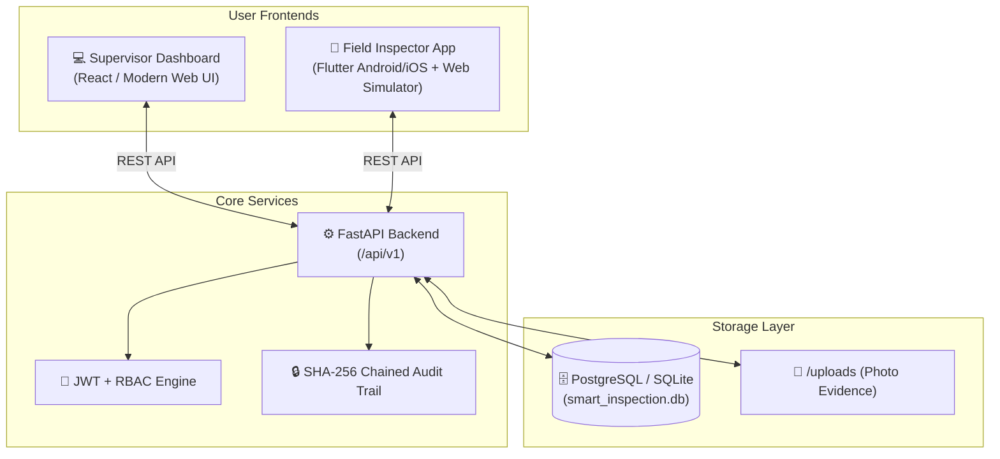

# 🛡️ Smart Inspection and Risk Prevention System
> **Capstone Project — Phase 1 (Semester 1): Core Inspection Engine & Data Pipeline**

A digital inspection platform engineered to replace paper checklists with verifiable field evidence, role-based workflows, tamper-evident auditability, and supervisor governance.

---

## 🏛️ System Architecture



---

## 🚀 Key Features Built in Phase 1

1. **Role-Based Access Control (RBAC):**
   * Three distinct roles: `Admin`, `Supervisor`, and `Field Inspector`.
2. **Facility & Regulated Sites Registry:**
   * Tracks facility category (Chemical, Food, Hospital, Construction, Cold Storage), registered GPS coordinates, and hazard risk ratings.
3. **Flexible Checklist Protocol Engine:**
   * Dynamic evaluation criteria templates with `Pass/Fail`, numeric ratings, and text notes.
4. **Inspection Scheduling & Fair Assignment:**
   * Supports manual assignment or **⚡ Fair Random Assignment** across active field inspectors.
5. **Verifiable Field Evidence:**
   * On-site device GPS coordinates and server timestamps locked to submitted findings.
   * On-site photo evidence capture with geofence proximity verification.
6. **Supervisor Review & Sign-Off:**
   * Supervisor inspects field checklist results, photo evidence, and visual distance comparison between Registered Facility GPS vs Inspector Submission GPS.
7. **Tamper-Evident Cryptographic Audit Trail:**
   * Every assignment, submission, and review operation is cryptographically linked using a **SHA-256 hash chain** (genesis block through current event) with an automated integrity verification tool.

---

## 📂 Project Directory Structure

```text
smart-inspection-system/
├── backend/
│   ├── app/
│   │   ├── config.py             # Settings (SQLite zero-config fallback & PostgreSQL)
│   │   ├── database.py           # SQLAlchemy session & engine
│   │   ├── models.py             # User, Facility, Inspection, Finding, AuditEvent
│   │   ├── schemas.py            # Pydantic request/response models
│   │   ├── auth.py               # JWT auth & SHA-256 audit hashing
│   │   ├── routers/
│   │   │   ├── auth_router.py
│   │   │   ├── facilities_router.py
│   │   │   ├── checklists_router.py
│   │   │   ├── inspections_router.py
│   │   │   └── audit_router.py
│   │   └── main.py               # FastAPI entrypoint, CORS, static routes
│   ├── uploads/                  # Uploaded photo evidence storage
│   ├── seed.py                   # Initial mock facilities, users & inspections
│   └── requirements.txt
├── frontend/
│   └── index.html                # Interactive Supervisor Web & Mobile Field Simulator
├── mobile/                       # Flutter Native Field Inspector App
│   ├── pubspec.yaml
│   └── lib/
│       ├── main.dart
│       ├── models/inspection.dart
│       ├── services/api_service.dart
│       └── screens/
│           ├── login_screen.dart
│           ├── task_list_screen.dart
│           └── inspection_form_screen.dart
└── README.md
```

---

## ⚡ Quick Start: How to Run the App

### 1. Instant Zero-Install Browser Demo
You can open `frontend/index.html` directly in any web browser (Google Chrome, Firefox, Edge).
* It contains a **complete standalone simulation engine** with pre-seeded facilities, inspection schedules, and a working **Field Inspector smartphone simulator** with on-site GPS verification and cryptographic audit log checks!

### 2. Running the FastAPI Backend
Once Python is installed on your machine:
```powershell
cd D:\project\backend

# 1. Install dependencies
pip install -r requirements.txt

# 2. Seed database with initial facilities, checklists & users
python seed.py

# 3. Launch the API server
uvicorn app.main:app --reload --port 8000
```
* **Interactive Swagger API Documentation:** Open `http://localhost:8000/docs`
* **Health Check:** `http://localhost:8000/health`

### 3. Running the Flutter Mobile App
Once Flutter SDK is installed:
```powershell
cd D:\project\mobile
flutter pub get
flutter run
```

---

## 🔑 Default Test Credentials

| Role | Email | Password | Badge Number |
|---|---|---|---|
| **Administrator** | `admin@inspect.gov.in` | `Admin@123` | `ADMIN-HQ-01` |
| **Supervisor** | `supervisor@inspect.gov.in` | `Super@123` | `SUPV-SOUTH-04` |
| **Field Inspector 1** | `rajesh@inspect.gov.in` | `Insp@123` | `INSP-2026-001` |
| **Field Inspector 2** | `priya@inspect.gov.in` | `Insp@123` | `INSP-2026-002` |

---

## 🎓 Capstone Viva Demonstration Guide (What to Show Examiners)

1. **Step 1 — Web Dashboard Overview:** Open the web app to display the active KPIs: Registered Sites, In-Progress Tasks, Reports Pending Review, and Completed Inspections.
2. **Step 2 — Scheduling & Fair Random Assignment:** Click **"Schedule & Assign Inspection"**, choose a chemical plant, select the hazardous material checklist, and click the **"⚡ Fair Random Assign"** button to automatically pick an available inspector.
3. **Step 3 — Field Mobile Execution:** Switch to the **Mobile Field App** tab. Show Inspector Rajesh Sharma opening the newly assigned inspection, reviewing the statutory questions, toggling Pass/Fail, acquiring real-time **GPS coordinates**, and submitting the report.
4. **Step 4 — Verifiable Evidence Review:** Switch back to the **Supervisor Web Dashboard**. Open the submitted report to show examiners the **GPS Geofence Match Card** (calculating distance offset between the factory coordinates and the inspector's submission coordinates).
5. **Step 5 — Formal Approval:** Add supervisor sign-off feedback and click **"Formal Sign-off & Approve"**.
6. **Step 6 — Cryptographic Audit Trail Verification:** Switch to the **Audit Trail** tab and click **"Verify Cryptographic Chain"**. Show the examiner that all system actions have an immutable SHA-256 hash signature proving no data was tampered with!
